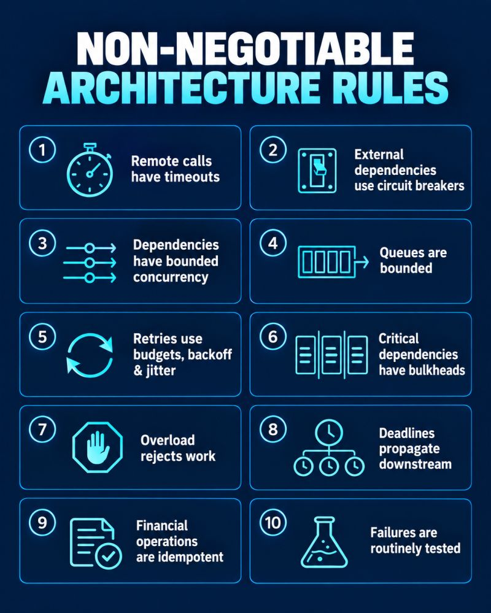

# Platform-Wide Resilience Principles

Most architecture failures aren’t caused by one bad line of code.

They happen when small, reasonable assumptions stack up: a dependency slows down, retries multiply traffic, queues grow without limit, and soon the whole platform is waiting on work it cannot finish.

That’s why resilience cannot be optional.

## Non-Negotiable Platform-Wide Rules

1. **Every remote call has a timeout.**  
   A call that waits forever eventually consumes every thread, connection, and worker available.

2. **Every external dependency has a circuit breaker.**  
   When a dependency is failing, stop sending it more traffic temporarily and give it room to recover.

3. **Every dependency has bounded concurrency.**  
   Limit in-flight calls so one slow service cannot exhaust the capacity needed by everything else.

4. **Every queue is bounded.**  
   Queues absorb short spikes—not unlimited demand. An unbounded queue is simply delayed failure.

5. **Every retry policy has a retry budget, backoff, and jitter.**  
   Retries must be controlled. Otherwise, they amplify an outage precisely when the system is weakest.

6. **Critical dependencies receive independent bulkheads.**  
   Isolate resources so a failure in one dependency does not sink unrelated critical paths.

7. **Overloaded systems reject work rather than accumulate unlimited work.**  
   A fast, explicit “no” is often safer than accepting work that will time out later anyway.

8. **Request deadlines propagate downstream.**  
   Every downstream service should know how much time is left—not start work that cannot finish in time.

9. **Critical financial operations are idempotent.**  
   A retry must never create a duplicate charge, transfer, refund, or settlement.

10. **External dependency failures are routinely injected.**  
    Resilience is not a document. Test latency, timeouts, partial outages, and recovery before production teaches the lesson for you.

## The Goal

**The goal is not to eliminate failure.**

**It is to ensure that failure stays contained, visible, and recoverable.**

 
